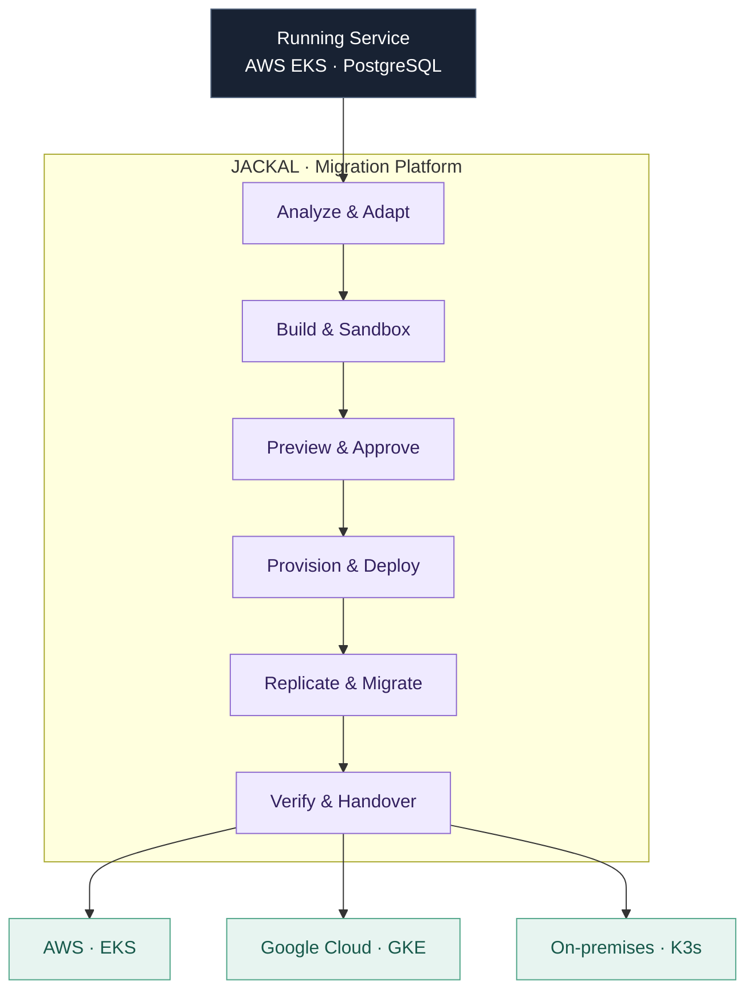

### SoftBank Hackathon 2026 — Finals

**TEAM JACKAL**

### Beyond Lock-In
**Frictionless Cloud Management Across Platforms**

운영 중인 Stateful 애플리케이션을 **클라우드의 경계를 넘어 안전하게 이전하는**  
**AI 기반 멀티클라우드 마이그레이션 플랫폼**

 

 
 

**Analyze · Adapt · Validate · Provision · Migrate**

 

## Technology Stack

**Application & API**

 

**Migration Workflow Orchestration**

 

**Cloud & Target Environments**

 

**Workload Runtime & Deployment**

 

**Infrastructure & Private Connectivity**

 

**Data & Artifacts**

 

 

## From a Running Service to a Running Service

클라우드를 옮기는 일은 컨테이너 이미지를 다른 환경에 배포하는 것만으로 끝나지 않습니다.  
네트워크와 스토리지, 애플리케이션 설정, **운영 중인 데이터와 사용자 트래픽**까지 함께 고려해야 합니다.

저희는 AWS 에서 운영 중인 백엔드 서비스를 분석하고, AI 기반 코드·설정 변환과 격리된 환경의 검증을 거쳐 **인프라·애플리케이션·데이터·트래픽을 하나의 마이그레이션 흐름으로 연결**합니다.

| **SOURCE** | **DESTINATIONS** |
|:--:|:--:|
| AWS EKS | **AWS EKS · Google Kubernetes Engine · On-premises K3s** |
| Running application + PostgreSQL | Kubernetes-based target environments |

 

## Why Jackal?

<table>
  <tr>
    <td width="50%" valign="top">
      <h3>🌐 Beyond Vendor Lock-In</h3>
      서로 다른 클라우드의 인프라 구성 차이를 다루며, 특정 환경에 종속되지 않는 이전 경로를 지향합니다.
    </td>
    <td width="50%" valign="top">
      <h3>🤖 AI-Assisted Adaptation</h3>
      기존 인프라와 소스코드의 의존성을 분석하고, 대상 환경에 필요한 코드와 설정 변환을 준비합니다.
    </td>
  </tr>
  <tr>
    <td width="50%" valign="top">
      <h3>🧪 Validate Before Change</h3>
      격리된 Sandbox에서 실행을 검증하고, 실제 인프라 변경은 Preview와 사용자 승인 이후 진행합니다.
    </td>
    <td width="50%" valign="top">
      <h3>🛡️ Stateful Migration</h3>
      PostgreSQL 데이터 복제와 정합성, 트래픽 전환과 단계별 복구 가능성을 함께 고려합니다.
    </td>
  </tr>
</table>

 

## One Journey, Multiple Destinations

  애플리케이션, 인프라, 데이터와 트래픽의 이전을 하나의 사용자 경험으로

 

## Our Approach

| Principle | What it means |
|:---|:---|
| **Plan Before Apply** | 실제 인프라 변경 전에 계획과 실행 산출물을 검토하고 승인합니다. |
| **Build Once, Deploy Consistently** | Sandbox에서 검증한 이미지 Digest를 실제 배포에서도 사용합니다. |
| **Separate AI from Execution** | AI의 분석·제안과 실제 운영 환경 변경의 책임을 분리합니다. |
| **Protect Stateful Workloads** | 데이터 복제·정합성 검증과 트래픽 전환의 경계를 고려합니다. |

 

## Meet Team Jackal

**One Team. One Mission. Beyond Lock-In.**

<table>
  <tr>
    <td align="center" width="25%">
       
      <a href="https://github.com/soulee-dev"><b>@soulee-dev</b></a> 
      Team Lead
    </td>
    <td align="center" width="25%">
       
      <a href="https://github.com/ikellllllll"><b>@ikellllllll</b></a>
    </td>
    <td align="center" width="25%">
       
      <a href="https://github.com/gumtiket"><b>@gumtiket</b></a>
    </td>
    <td align="center" width="25%">
       
      <a href="https://github.com/kmsdevdata-sketch"><b>@kmsdevdata-sketch</b></a>
    </td>
  </tr>
</table>

 

 
 

*Build beyond boundaries. Migrate with confidence.*

