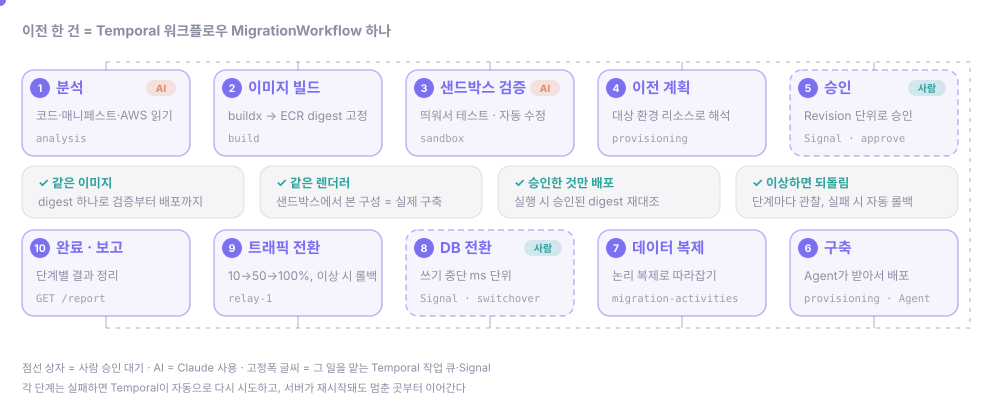
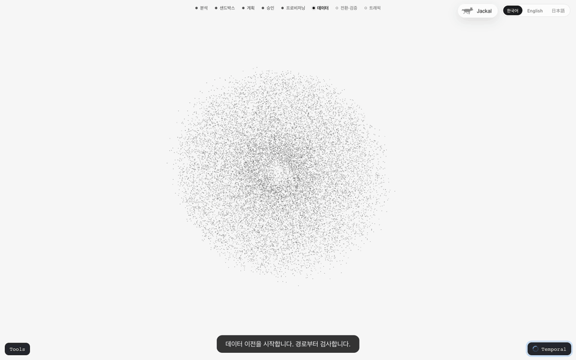
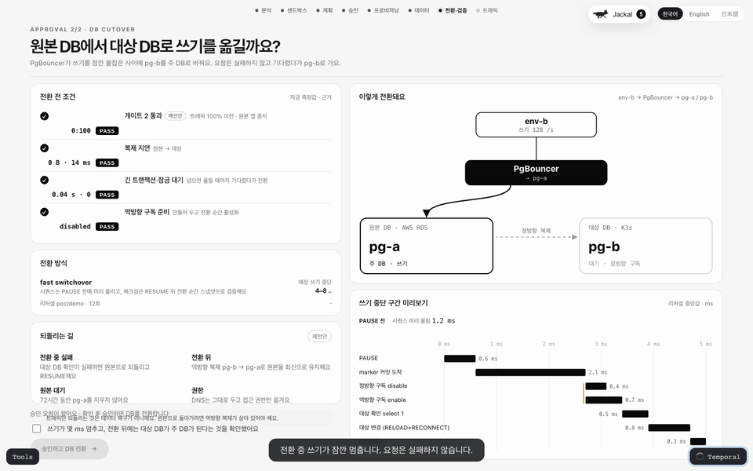
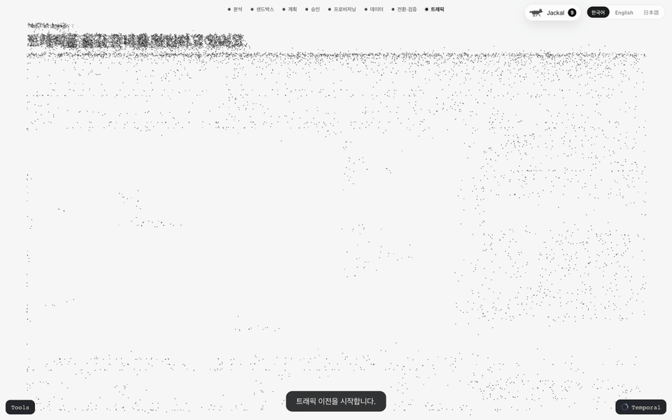

### SoftBank Hackathon 2026 — Finals

**TEAM JACKAL**

### Beyond Lock-In
**Frictionless Cloud Management Across Platforms**

운영 중인 Stateful 애플리케이션을 **클라우드의 경계를 넘어 안전하게 이전하는**  
**AI 기반 멀티클라우드 마이그레이션 플랫폼**

 

 
 

**Analyze · Adapt · Validate · Provision · Migrate**

 

## Technology Stack

**Application & API**

 

**Migration Workflow Orchestration**

 

**Cloud & Target Environments**

 

**Workload Runtime & Deployment**

 

**Infrastructure & Private Connectivity**

 

**Data & Artifacts**

 

 

## Repositories

| 저장소 | 역할 |
| :--- | :--- |
| [cloud-migration-platform](https://github.com/SoftBank-Hackathon-2026-Team-Jackal/cloud-migration-platform) | 이전 플랫폼 본체. 분석, 이미지 빌드, 샌드박스 검증, 배포 계획·승인, 온프레미스 Agent, 데이터 복제, 트래픽 전환을 담당하는 API와 Temporal 워커 |
| [cloud-migration-web](https://github.com/SoftBank-Hackathon-2026-Team-Jackal/cloud-migration-web) | 사용자가 이전을 시작하고 단계별 진행 상황을 보고 승인하는 웹 화면 |
| [demo-app](https://github.com/SoftBank-Hackathon-2026-Team-Jackal/demo-app) | 데모에서 옮기는 원본 앱. 메시지마다 어느 환경과 DB가 처리했는지 남기는 채팅 앱 |
| [demo-application](https://github.com/SoftBank-Hackathon-2026-Team-Jackal/demo-application) | 초기 데모용 원본 앱과 시각화 웹. 현재 데모는 demo-app을 사용 |
| [Softbank-Hackathon-2026-Finals](https://github.com/SoftBank-Hackathon-2026-Team-Jackal/Softbank-Hackathon-2026-Finals) | 대회 자료, 설계 메모, PoC 기록 |

 

## Workflow

  

운영 중인 EKS의 앱과 PostgreSQL을 분석해 이미지를 만들고, 격리된 샌드박스에서 먼저 검증합니다. 대상 환경에 맞춘 배포 계획을 사람이 승인하면 배포하고, 데이터를 복제한 뒤 짧은 쓰기 중단으로 DB를 전환하고 트래픽을 단계적으로 옮깁니다. 이 과정은 Temporal 워크플로우 하나로 이어지며, 자세한 내용은 [플랫폼 README](https://github.com/SoftBank-Hackathon-2026-Team-Jackal/cloud-migration-platform#readme)에 있습니다.

 

  
  
  
   
  데이터 복제 · DB 전환 · 트래픽 전환 (웹 화면, 목업 데이터로 캡처)

 

## Meet Team Jackal

**One Team. One Mission. Beyond Lock-In.**

<table>
  <tr>
    <td align="center" width="25%">
       
      <a href="https://github.com/soulee-dev"><b>@soulee-dev</b></a> 
      Team Lead
    </td>
    <td align="center" width="25%">
       
      <a href="https://github.com/ikellllllll"><b>@ikellllllll</b></a>
    </td>
    <td align="center" width="25%">
       
      <a href="https://github.com/gumtiket"><b>@gumtiket</b></a>
    </td>
    <td align="center" width="25%">
       
      <a href="https://github.com/kmsdevdata-sketch"><b>@kmsdevdata-sketch</b></a>
    </td>
  </tr>
</table>

 

 
 

